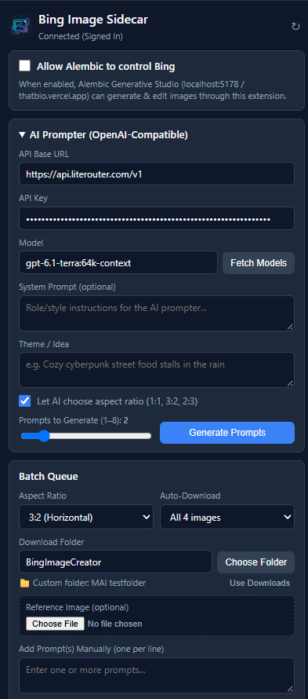

# Bing Image Sidecar Orchestrator

A Chrome Manifest V3 side-panel extension for automating **Bing Image Creator** (`bing.com/images/create`) with sequential batch queues, OpenAI-compatible AI prompting, reference image uploads, Edit Image & Restyle actions, full-resolution auto-downloads, and an **Alembic Generative Studio** bridge.

  

## Features

- **Sequential Batch Queue:** Runs prompts one by one (**Prompt → Generate → Auto-Download → Next**) with pause/resume support and per-item status/error reporting.
- **OpenAI-Compatible AI Prompter:** Connect any OpenAI-compatible API endpoint (OpenAI, LiteRouter, OpenRouter, Ollama, LM Studio, etc.), fetch available models with one click (**Fetch Models**), generate **1–8** prompts from a theme/idea, and optionally **let the AI choose the aspect ratio** (`1:1`, `3:2`, or `2:3`) per prompt.
- **Full-Resolution Auto-Download & Custom Folder Picker:** Automatically downloads generated images at full quality (`?pid=ImgGn`) into either a custom folder chosen via the native folder picker (**Choose Folder**) or a subfolder inside Chrome's Downloads directory.
- **Reference Images, Edit Image & Restyle:** Attach reference images (`.jpg`, `.png`, `.gif`, `.webp`), run **Edit Image** on any of the 4 generated results, or apply any of Bing's **8 Restyle presets** (`Photo`, `Anime`, `3D Cartoon`, `Cartoon`, `Flat graphics`, `Painting`, `Sketch`, `Vintage`) with automatic download.
- **Sign-In / Watermark Check:** Detects when Bing is signed out, pauses with a watermark notice, and lets you sign in first or explicitly continue without logging in.
- **Alembic Generative Studio Integration:** Includes a `window.postMessage` page bridge (`bridge/alembic-bridge.js`) and an **"Allow Alembic to control Bing"** toggle so [Alembic Generative Studio](https://github.com/thatBiologyStudent/alembic-generative-studio) can drive Bing Image Creator directly.

## Installation

1. Download **`bing-image-sidecar-orchestrator-vX.Y.Z.zip`** from the [latest release](../../releases/latest) and unzip it to a folder you will keep (Chrome loads the extension from there).
2. Open `chrome://extensions` in Chrome and enable **Developer mode** (top right).
3. Click **Load unpacked** and select the unzipped folder (the one that contains `manifest.json`).
4. Open [Bing Image Creator](https://www.bing.com/images/create/ai-image-generator) and click the **Bing Image Sidecar Orchestrator** toolbar icon to open the side panel.

**Updating:** download the new release zip, replace the files in your extension folder with the new ones, then press **Reload** on the extension's card in `chrome://extensions`. Your settings are kept.

The release also has a signed **`.crx`**, but Chrome usually blocks extensions installed from a CRX outside the Web Store, so the zip is the recommended way. If you want to work on the code, clone the repository and load the repository folder instead.

## Alembic Integration

1. Open Bing Image Creator in a Chrome tab (sign in to Microsoft if you want watermark-free images).
2. Open the **Bing Image Sidecar Orchestrator** side panel and tick **Allow Alembic to control Bing**.
3. Connect the `bing-sidecar` provider in [Alembic Generative Studio](https://github.com/thatBiologyStudent/alembic-generative-studio) (`http://localhost:5178`, `http://127.0.0.1:5178`, or `https://thatbio.vercel.app`).
